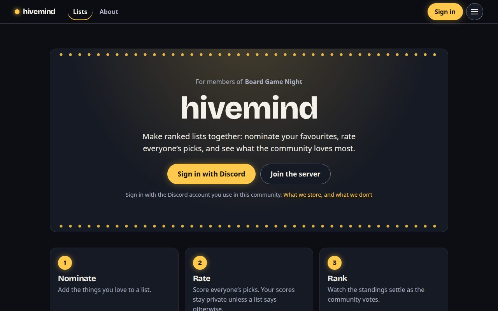
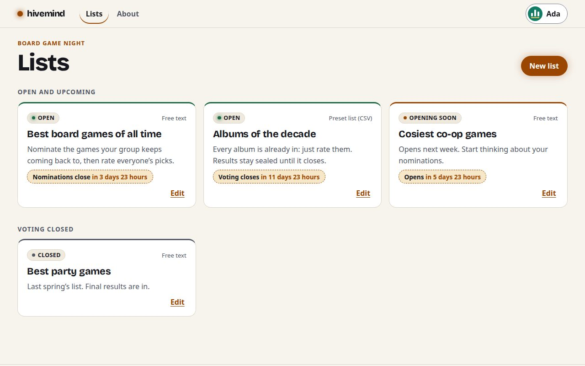
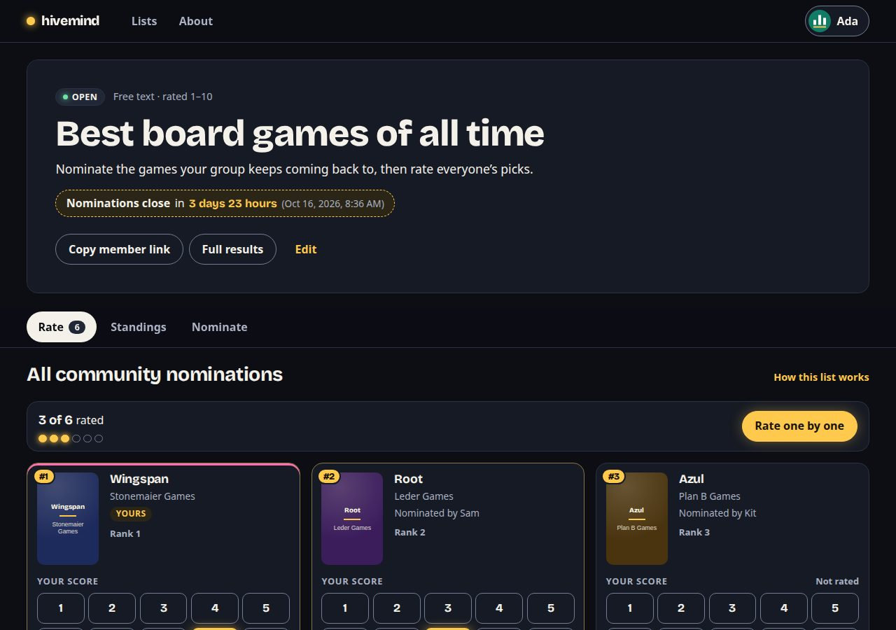
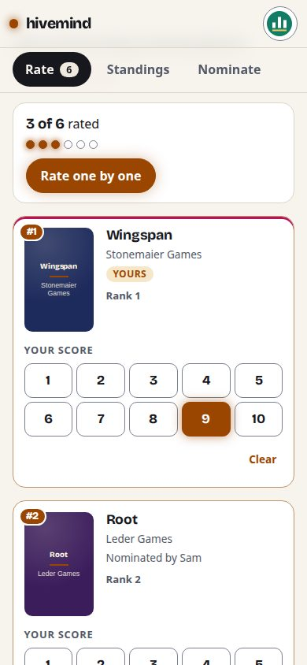
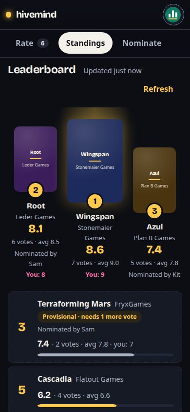
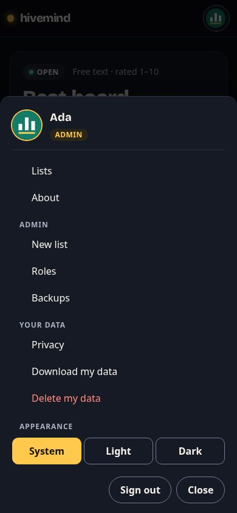

# hivemind

hivemind is a platform for members of a Discord community to create ranked lists, nominate items, and rate them. Each deployment has its own site name, configured with `VITE_SITE_NAME` in its environment; if unset, the site is called hivemind.

Each list ranks itself. One deployment serves one Discord community. To run hivemind for your own community, fork the repository and deploy your fork. Nothing community-specific lives in the code.



| Lists                                          | A list                                               |
| ---------------------------------------------- | ---------------------------------------------------- |
|  |  |

| Rating on a phone                                            | Standings                                                         | One menu                                           |
| ------------------------------------------------------------ | ----------------------------------------------------------------- | -------------------------------------------------- |
|  |  |  |

Screenshots use sample data (`npm run screenshots` retakes them). The look is a theme you can replace: see [docs/theming.md](docs/theming.md).

## Deploy your own

1. **Discord application.** Follow [docs/discord-setup.md](docs/discord-setup.md) to register the app, choose your `SITE_URL`, and collect your server and admin role IDs.
2. **Netlify site.** Create a site from your fork. The build settings come from `netlify.toml`.
3. **Environment.** In the Netlify site settings, set the variables listed in `.env.example`, including `SITE_URL`. If you later move to a custom domain, update `SITE_URL` and the Discord redirect URI together. The Environment section of [AGENTS.md](AGENTS.md) describes each one. Movie lists need `TMDB_READ_TOKEN` ([setup](docs/tmdb-setup.md)); TV show lists need `TVDB_READ_TOKEN` ([setup and licensing](docs/tvdb-setup.md)); game lists need both `IGDB_CLIENT_ID` and `IGDB_CLIENT_SECRET` ([setup and usage rights](docs/igdb-setup.md)). Each source is offered only when its own credentials are set.
4. **Deploy.** Members of your Discord server can now sign in. Admins, meaning holders of the `ADMIN_ROLE_ID` role plus anyone listed in `ADMIN_MEMBER_IDS`, can create lists.

## Develop

Requires Node 22 (see `.nvmrc`).

```sh
npm install
cp .env.example .env   # fill in the values
npm run dev            # netlify dev: web app + functions
npm run check          # typecheck, lint, boundary rules, formatting, tests
```

Open `http://localhost:8888`. Use `npm run dev` rather than invoking `netlify dev` directly:
the launcher cleans up its child processes on exit, including after a Netlify CLI crash.
On Linux and macOS, Netlify and Vite run in an owned process group so stopping the launcher
also stops Vite. Ports 8888 and 5173 stay fixed; unrelated processes using them are never killed.
On Linux, running `npm run dev` again recognizes an existing server from this workspace and
prints its URL without launching a competing session. If only an orphaned workspace Vite
server remains, the launcher stops it before starting Netlify. Ownership is verified using
`ss` and `/proc`; if it cannot be verified, the launcher reports the occupied port and stops.
Force-killing the launcher with `SIGKILL` bypasses exit cleanup. Use Ctrl+C in the original
dev terminal to stop a running session. Explicit CLI options (`npm run dev -- ...`) are
passed directly to Netlify without the default-port startup checks.

## Demo mode and previews

With `DEMO_MODE=true` (set in `.env.example`), local dev and Netlify deploy previews show **Try as Demo Admin / Member A / Member B** buttons and a set of sample lists, so the site can be explored without Discord. To enable it on previews, set `DEMO_MODE=true` for the _Deploy previews_ context in Netlify's environment variables. It never runs in production, even if set there, and previews use their own empty data, never the real lists.

## Operations

- **Permanently deleting a list:** Admins can use the editor's **Danger zone** in any lifecycle, including drafts and archives. Review the warning and type the current slug before confirming. Deletion removes all entries (including withdrawn ones), nomination records, ballots and the leaderboard, and releases the slug only after cleanup. It does not remove accounts or shared catalog presets. A replacement list gets a new internal ID with no inherited entries or votes; old shared links can lead to that replacement. Previously downloaded backups are not erased and can restore a separate copy.
- **Retrying interrupted deletion:** once confirmed, deletion cannot be cancelled. Members cannot access the list, and Admins cannot edit it. It remains marked **Deletion in progress** for Admins; open its editor and use **Retry deletion**. Pending-list links use its immutable ID so recovery still works if its slug has already been released and reused. Earlier admitted writes cause `lists.deletion-busy`; retry after they finish. Storage failures leave the operation resumable, not successful. If an unfinished write marker persists, use the operator procedure below. Completed deletion retains only a non-personal ID fence and an empty slug reservation record to stop stale requests from recreating or releasing data.
- **Correcting an unused list:** Admins can change the item source of a scheduled or open nomination list from its editor until an entry has been added. Withdrawn entries still count; published seeded lists, entry mode, rating rules and finished lists stay locked. Sources are validated again on save. An unfinished nomination or import temporarily prevents a source change.
- **Interrupted writes:** nominations, publication, imports, ballot changes and leaderboard cache writes use anonymous `entry-write/{listId}/{token}` markers in the lists store. They are removed after success or a domain-rule rejection. If an adapter throws, an invocation is terminated or cleanup fails, a marker can remain and block source changes or deletion. Ordinary participation is unaffected unless deletion has already started. Adapter errors leave protection in place because a remote write may still finish after the error. The API reports `lists.source-write-in-progress` for a source edit or `lists.deletion-busy` for deletion. Do not expire markers automatically: first stop traffic and verify all writing invocations and any outstanding remote writes have ended, inspect the list and its entries, then remove only the orphaned marker before retrying. Removing a live marker defeats the concurrency safeguard.
- **Shared links:** the homepage and list links include Open Graph and Twitter previews with the site and community names. Published, non-hidden lists also include their title; entries, scores and member details stay behind sign-in. Draft and hidden lists get the generic site preview. Social platforms may cache an earlier preview after a list is hidden.
- `npm run seed` creates the first list, "Best Sci-Fi Movies" (TMDB, 1–10), as a draft. Locally it writes to `netlify dev`'s data; with `NETLIFY_SITE_ID` and `NETLIFY_AUTH_TOKEN` (a personal access token) set, to the deployed site. Running it again does nothing.
- `npm run check:headers -- https://your-site.netlify.app` checks a deployed site's security headers. A GitHub Action runs it after every Netlify deploy.
- **Backups:** set `BACKUP_KEY` and Admins can download and import lists from **Backups** in the account menu. Votes stay sealed inside the file, members who deleted their data are never restored, and imports never overwrite. Keep the key safe: without it, votes in a backup can't be restored.
- A daily scheduled function removes movie details from lists archived more than 6 months ago, as TMDB's terms require.

## Architecture

[AGENTS.md](AGENTS.md) is the architecture contract: the bounded contexts, the dependency rules (enforced by dependency-cruiser), the domain invariants, and the security and privacy requirements. Read it before changing code.

## License and content

- **Code.** Copyright © Moriel Schottlender ([moriel.tech](https://moriel.tech)). Licensed under the GNU General Public License, version 3 or (at your option) any later version; see [LICENSE](LICENSE). If you run a modified version for others, the GPL requires you to share your changes under the same license.
- **Community content.** The lists, nominations, descriptions, imported CSVs and scores that a community creates belong to that community and its members. They are not part of this software and are not covered by its license.
- **Movie data.** Titles, years and posters come from [TMDB](https://www.themoviedb.org/) and are used under [TMDB's terms of use](https://www.themoviedb.org/api-terms-of-use). This product uses the TMDB API but is not endorsed or certified by TMDB.
- **TV series data.** Titles, years, artwork, synopses and available credits come from [TheTVDB](https://thetvdb.com/), under the deployment operator's API license, not the software's GPL license. Confirm access, attribution and retention rights before enabling it; see [docs/tvdb-setup.md](docs/tvdb-setup.md).
- **Game data.** Titles, release years, covers, synopses, and developer/publisher companies come from [IGDB](https://www.igdb.com/), under the [Twitch Developer Services Agreement](https://www.twitch.tv/p/en/legal/developer-agreement/), not the software's GPL license. Free API access is for non-commercial use; confirm usage and retention rights before enabling it. See [docs/igdb-setup.md](docs/igdb-setup.md).
